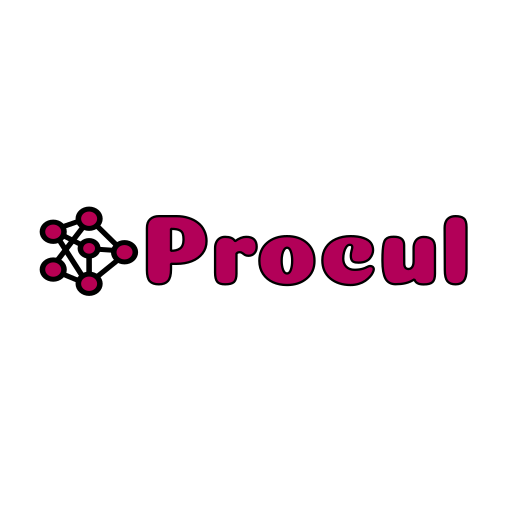

<div align="center">



# Procul

**A streaming, tool-using chat app — an ASP.NET Core backend and a Flutter client.**

</div>

---

## ⚠️ This project was vibe-coded

Let's get this out of the way: **this repository was built by "vibe coding" with AI agents.**
The human involved wrote little to none of the code by hand. Strictly speaking, it isn't
their work — it's the output of an AI pair (or, more accurately, an AI driver) that was
steered, reviewed, and iterated on.

This started as an experiment: **how good is vibe coding, really, in 2026?** The honest
answer so far is **very, very impressive**. The app runs, streams, calls tools, renders
Markdown, persists conversations, has tests, and ships as a container — all from
natural-language direction. Treat the code accordingly: it is a demonstration, not a
hardened product. There is no warranty, no support, and no promise that any of it is the
*right* way to do things.

If you're here to judge the code, judge it as a snapshot of what AI-assisted development
looks like today. If you're here to use it, enjoy — but read the code first.

---

## What is Procul?

Procul is a small ChatGPT-style chat application:

- A **.NET 10 / ASP.NET Core minimal-API backend** that stores conversations in PostgreSQL,
  streams assistant replies over **Server-Sent Events (SSE)**, and lets the model call
  **tools** (current time, and a sandboxed Python interpreter).
- A **Flutter client** (Linux desktop, web, and mobile) with multiple conversations
  (list / switch / rename / delete), streaming replies, tool-activity display, Markdown
  rendering, a persisted light/dark theme, and **multiple saved server profiles** behind a
  shared-password sign-in.

The model is reached through [`Microsoft.Extensions.AI`](https://learn.microsoft.com/dotnet/ai/microsoft-extensions-ai)
against [OpenRouter](https://openrouter.ai/).

## Features

- **Streaming replies** over SSE, with a `type`-tagged event protocol (`created`,
  `acknowledge`, `token`, `toolCall`, `toolResult`, `title`, `error`, `done`).
- **Agent tools** the model can call mid-turn: `get_current_time` and `run_python`
  (a contained, file/network-denying Python subset via `Lokad.Lython`).
- **MCP tool servers**: connect to remote Streamable HTTP / SSE MCP servers, discover their
  tools, and expose them to the model (namespaced `{server}__{tool}`), with live status in the
  client's Settings.
- **AI-generated conversation titles** produced concurrently with the first reply.
- **Multi-conversation UI** with rename, delete, and keyset-paginated history.
- **Responsive shadcn UI** with dark mode by default, hand-rolled skeletons, and subtle
  motion.
- **Password-protected API** with expiring HS256 session tokens stored in the device's secure
  storage, plus a public `/health` probe.
- **Multiple server profiles** the client can add, switch between, and remove.
- **Versioned API** (`/v1/conversations`) built for additive evolution.
- **Containerized backend** published to GitHub Container Registry on version tags.

## Repository layout

```
.
├── backend/                 # ASP.NET Core (.NET 10) API
│   ├── src/Procul.Api/       # the API project
│   │   ├── Chat/             # endpoints, streaming service, tools, DTOs, entities
│   │   ├── Cors/             # browser CORS policy
│   │   ├── Security/         # shared-password auth: verifier, session JWTs, endpoints
│   │   ├── Infrastructure/   # EF Core DbContext
│   │   ├── Migrations/       # EF Core migrations
│   │   ├── Versioning/       # API versioning
│   │   ├── Dockerfile        # multi-stage, cache-friendly image
│   │   └── justfile          # local dev helpers (docker compose + dotnet run)
│   ├── tests/Procul.Api.Tests/  # xUnit unit + integration tests
│   ├── Procul.slnx           # solution
│   └── AGENTS.md             # backend conventions & gotchas
├── frontend/                # Flutter client
│   ├── lib/                  # app + src (API client, controllers, UI)
│   ├── test/                 # unit + widget tests
│   └── AGENTS.md             # frontend conventions & gotchas
├── assets/                  # logo
└── .github/workflows/       # CI + container publishing
```

Each of `backend/` and `frontend/` has its own **`AGENTS.md`** with the detailed
architecture, conventions, and hard-won gotchas. Those are the best place to start reading.

## Tech stack

| Layer    | Technology |
| -------- | ---------- |
| Backend  | .NET 10, ASP.NET Core minimal APIs, EF Core 10 + Npgsql, `Microsoft.Extensions.AI`, `Asp.Versioning`, `Lokad.Lython` |
| Database | PostgreSQL |
| Frontend | Flutter (Dart 3), `shadcn_flutter`, `gpt_markdown`, `google_fonts`, `package:http`, `flutter_secure_storage` |
| Model    | OpenRouter (any model slug you configure) |
| CI/CD    | GitHub Actions, Docker Buildx, GitHub Container Registry |

## Getting started

### Prerequisites

- [.NET 10 SDK](https://dotnet.microsoft.com/download)
- [Docker](https://www.docker.com/) (for the dev Postgres, and for building the image)
- [Flutter](https://flutter.dev/) (for the client)
- [just](https://github.com/casey/just) (optional, for the backend dev helpers)
- An [OpenRouter](https://openrouter.ai/) API key

### Backend

```bash
cd backend
dotnet build Procul.slnx            # build the solution
dotnet test  Procul.slnx            # run the tests (no database or network needed)
```

Create the environment file (it is git-ignored — **never commit it**):

```bash
cp backend/src/Procul.Api/.env.example backend/src/Procul.Api/.env
# then edit .env and fill in your values
```

Run it (starts Postgres via Docker Compose, then the API):

```bash
cd backend/src/Procul.Api
just run-dev                        # docker compose up + dotnet run
```

The API listens on **http://localhost:5010**. Migrations are applied automatically at
startup — the app creates the database if needed and applies any pending migrations.

### Frontend

```bash
cd frontend
flutter pub get
flutter run -d linux                # native Linux desktop
flutter run -d chrome               # web
```

The base URL defaults to `http://localhost:5010` and can be overridden at build time:

```bash
flutter run -d linux --dart-define=PROCUL_API_BASE=http://localhost:5010
```

On first launch the app shows a **Connect** screen: enter the server URL (pre-filled from
`PROCUL_API_BASE`) and the backend's `PROCUL_API_PASSWORD`. The session token is stored in the
device's secure storage, and Settings lets you add, switch between, and remove **multiple
server profiles** or log out.

## Configuration

The backend reads its configuration from environment variables (and the git-ignored
`.env` file in development):

| Variable | Purpose |
| -------- | ------- |
| `ConnectionStrings__ChatContext` | PostgreSQL connection string |
| `OPENROUTER_API_KEY` | OpenRouter API key (**required**) |
| `OPENROUTER_MODEL_SLUG` | Model slug to use, e.g. `nvidia/nemotron-3-ultra-550b-a55b:free` (**required**) |
| `PROCUL_API_PASSWORD` | Shared password protecting the API (**required**) |
| `PROCUL_SESSION_LIFETIME` | Session-token lifetime, e.g. `12h` (default `30d`) |
| `CORS_ALLOWED_ORIGINS` | Comma-separated browser origins allowed to call the API |
| `PROCUL_CONFIG_PATH` | Path to the MCP config file (default `config.jsonc` next to the app) |
| `MCP_ENABLED` | Master switch for MCP support (default `true`) |
| `MCP_CONNECT_TIMEOUT` | Per-server connect/discover budget, e.g. `15s` |
| `MCP_HEALTH_INTERVAL` | Background ping/reconnect cadence, e.g. `60s` |

`.env.example` documents the shape. **No secrets are committed to this repository**, and
the container image is environment-agnostic — configuration is injected at run time.

### MCP tool servers

The model can call tools from remote [MCP](https://modelcontextprotocol.io/) servers
(Streamable HTTP and legacy SSE) in addition to the built-in ones. Servers are declared in a
`config.jsonc` file, kept separate from secrets:

- **Structure** lives in `config.jsonc` (bind-mountable, committable) — copy
  `backend/src/Procul.Api/config.jsonc.example` to start.
- **Secrets** stay in `.env`; the JSON references them as `${VAR}` in a URL or header value.
  An unresolved reference fails startup and names the missing variable.

```jsonc
{
  "mcpServers": {
    "github": {
      "type": "http",                                  // "http" | "sse"
      "url": "https://api.githubcopilot.com/mcp/",
      "headers": { "Authorization": "Bearer ${GITHUB_MCP_TOKEN}" },
      "enabled": true                                  // optional, default true
    }
  }
}
```

On startup the backend connects to every enabled server, discovers its tools, and logs a
per-server status; a server that is down is retried in the background and never blocks startup.
Tools are namespaced `{server}__{tool}`. The authenticated `GET /v1/mcp/servers` endpoint reports
live status (never headers or tokens), and the client shows it read-only in Settings.

### CORS in production

Native desktop and mobile clients are not subject to CORS, but a **Flutter web build is**.
The rules are:

- **Development:** if `CORS_ALLOWED_ORIGINS` is unset, any origin is allowed (the web dev
  server's port is ephemeral). This never applies outside development.
- **Production (and any other environment):** there is **no wildcard**. Cross-origin
  requests are denied until you set `CORS_ALLOWED_ORIGINS` to the frontend's real origin,
  e.g. `CORS_ALLOWED_ORIGINS=https://app.example.com`. A wildcard (`*`) or a malformed
  origin makes startup fail fast.

Build the production web client against your API's public URL:

```bash
flutter build web --release --dart-define=PROCUL_API_BASE=https://api.example.com
```

## Testing

```bash
# Backend: unit + integration tests (xUnit), no database or network required
dotnet test backend/Procul.slnx

# Frontend: unit + widget tests
cd frontend && flutter test
cd frontend && flutter analyze     # must stay clean
```

The backend suite covers title generation and sanitization, tool invocation (time and the
Python sandbox), the SSE/JSON wire contract, API versioning, and the CORS policy —
including a full `WebApplicationFactory` preflight test against the real pipeline.

## Container image

The backend ships as a multi-stage image (`backend/src/Procul.Api/Dockerfile`): a .NET 10
SDK stage restores and publishes, and a slim ASP.NET Core runtime stage runs the app as a
non-root user on port `8080`. The NuGet restore layer is cached independently of the source
(and via a BuildKit cache mount), so repeat builds are fast.

The container manages its own schema: on startup it applies pending EF Core migrations
(creating the database if needed), so no separate `dotnet ef` step is required. It only
needs the connection string above to point at a reachable PostgreSQL.

Build and run it locally:

```bash
docker build -f backend/src/Procul.Api/Dockerfile -t procul-api backend

docker run --rm -p 8080:8080 \
  -e OPENROUTER_API_KEY=sk-or-v1-... \
  -e OPENROUTER_MODEL_SLUG=nvidia/nemotron-3-ultra-550b-a55b:free \
  -e ConnectionStrings__ChatContext="Host=...;Port=5432;Database=procul;Username=...;Password=..." \
  -e CORS_ALLOWED_ORIGINS=https://app.example.com \
  -e PROCUL_API_PASSWORD=a-strong-shared-password \
  -e GITHUB_MCP_TOKEN=ghp_... \
  -v ./config.jsonc:/app/config.jsonc:ro \
  procul-api
```

The `-v` mount injects the MCP config read-only; tokens referenced as `${VAR}` come from `-e`
(or the environment), so the mounted file stays secret-free. The runtime image is ASP.NET-only,
which is fine: remote MCP transports spawn no child processes.

### Publishing

Publishing is **tag-driven**. Push a `v*` tag and the
[`publish-backend-image`](.github/workflows/publish-backend-image.yml) workflow tests the
solution and pushes the image to GitHub Container Registry:

```
ghcr.io/<owner>/<repo>/backend-api:<version>
ghcr.io/<owner>/<repo>/backend-api:<major>.<minor>
ghcr.io/<owner>/<repo>/backend-api:<major>
ghcr.io/<owner>/<repo>/backend-api:sha-<commit>
ghcr.io/<owner>/<repo>/backend-api:latest      # stable tags only
```

It authenticates with the built-in `GITHUB_TOKEN` (`packages: write`) — no extra secrets —
and reuses the Docker layer cache through the Actions cache API.

## Continuous integration

- [`ci.yml`](.github/workflows/ci.yml) builds and tests the backend on pushes to `main` and
  on pull requests.
- [`publish-backend-image.yml`](.github/workflows/publish-backend-image.yml) tests and
  publishes the container image on `v*` tags.

## License & disclaimer

No license is currently declared. The code is provided **as-is**, with no warranty of any
kind. It is a vibe-coding experiment — **use it, fork it, learn from it, but don't trust it
in production without reviewing it yourself.** See the note at the top of this README.
